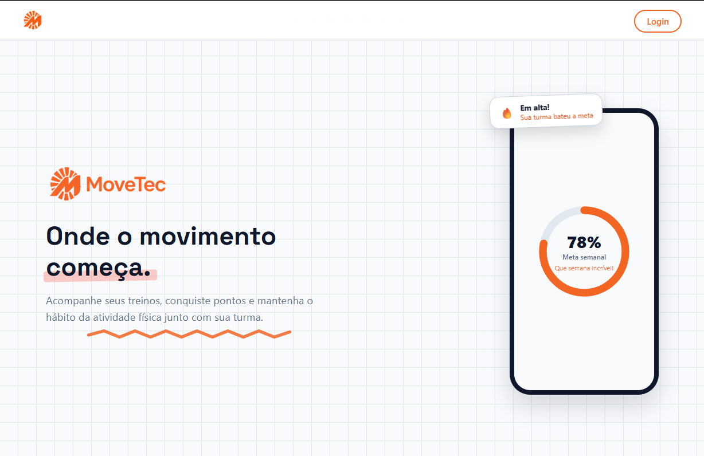
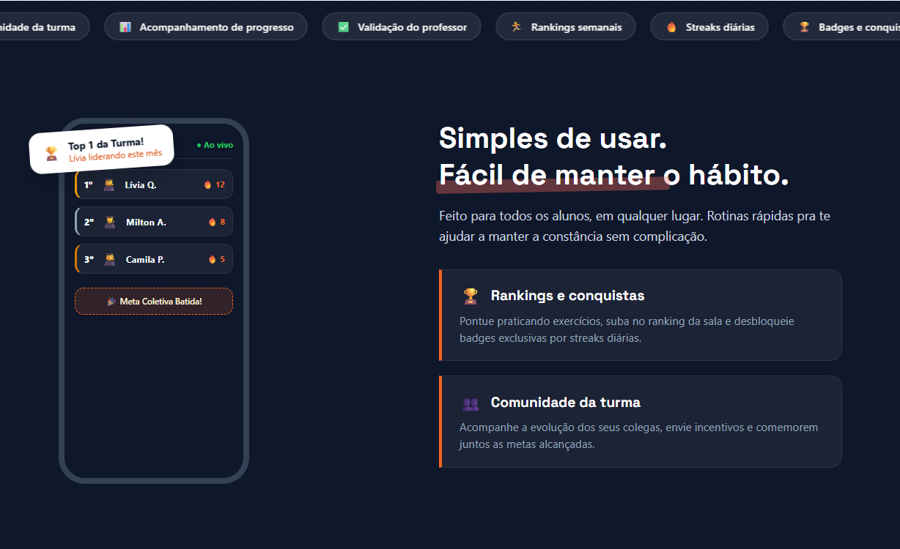
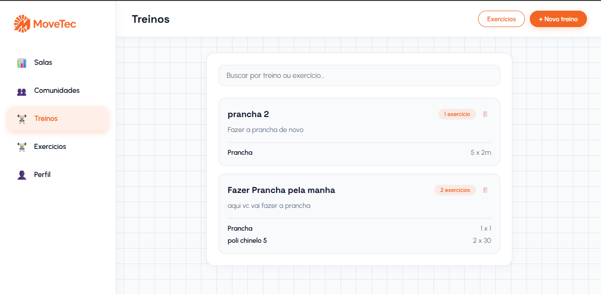
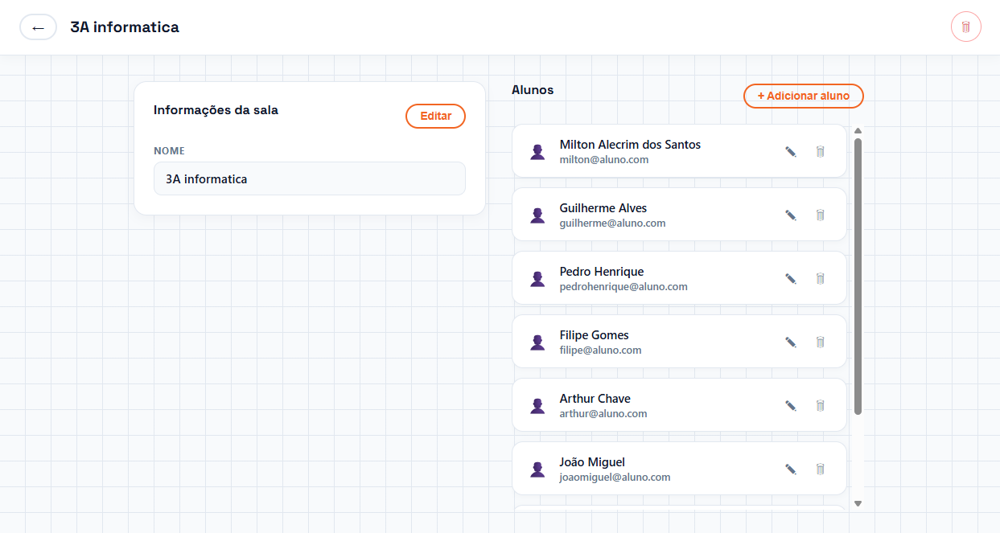

<div align="center">

# MoveTec — Sistema Web para Incentivo à Prática de Atividades Físicas no Ambiente Escolar


<p align="center">
  <strong>Trabalho de Conclusão de Curso (TCC) — ETEC de Campo Limpo Paulista</strong><br>
  <em>Habilitação Profissional Técnica de Nível Médio em Desenvolvimento de Sistemas</em>
</p>

---

</div>

## 📌 Descrição

O **MoveTec** é uma plataforma web desenvolvida para combater o sedentarismo e incentivar a prática regular de atividades físicas entre estudantes do ensino médio e técnico. 

Estudos indicam que a transição para o ensino médio/técnico e a rotina escolar intensa provocam uma redução drástica no tempo dedicado ao movimento, gerando fadiga mental, falta de foco e impactos negativos na saúde física e emocional. 

O MoveTec soluciona esse problema criando uma ponte digital e motivadora entre **alunos** e **professores de Educação Física**:
- **Para o Aluno:** Oferece rotinas guiadas de exercícios rápidos, acompanhamento visual de metas semanais, histórico de desempenho, desafios, ranking saudável da turma e uma comunidade integrada com chat em tempo real para incentivo mútuo.
- **Para o Professor:** Centraliza o planejamento pedagógico, cadastro de exercícios e montagem de fichas de treino personalizadas, além da validação de atividades executadas pelos discentes.
- **Para a Escola/Administração:** Fornece um painel completo para gestão de salas, matrículas e acompanhamento de adesão discente.

---

## 👥 Equipe

| Foto / Integrante | Nome | Função |
| :--- | :--- | :--- |
| 👩‍💻 | **Camila Pelinson e Silva** | UI/UX Design, Front-end & Documentação |
| 👩‍💻 | **Livia Rafaelli Quatroque** | Front-end, Pesquisa de Campo & Usabilidade |
| 👨‍💻 | **Milton Alecrim dos Santos** | Full Stack (Back-end & Front-end) & Banco de Dados |

### 🎓 Corpo Docente / Orientação
- **Profª. Barbara Porfirio** — Orientadora de TCC / Usabilidade e Design
- **Profª. Thaynara Maia** — Orientadora de TCC / Metodologia e Desenvolvimento

---

## 💻 Tecnologias Utilizadas

### Front-end
- **HTML5 & CSS3** (Design responsivo, Glassmorphism e CSS Grid/Flexbox)
- **JavaScript (ES2024) / TypeScript** `v6.0.2`
- **React** `v19.2.8`
- **Vite** `v8.2.0` (Build tool e dev server de alta performance)
- **React Router DOM** `v7.18.2` (Roteamento dinâmico SPA)
- **Axios** `v1.19.0` (Comunicação com a API REST)
- **Socket.io Client** `v4.8.3` (Comunicação em tempo real para chat e notificações)
- **React Icons** `v5.7.0` & **Canvas-Confetti** `v1.9.4` (Feedback visual e gamificação)

### Back-end
- **Node.js** `v22.14.0` (LTS)
- **Express** `v5.2.1` (Servidor HTTP e API REST)
- **Socket.io** `v4.8.3` (WebSockets para comunidades e mensagens instantâneas)
- **JSON Web Token (JWT)** `v9.0.3` (Autenticação e controle de sessões seguras)
- **Passport.js & Passport-Local** `v0.7.0` (Estratégias de autenticação)
- **Express Mongo Sanitize** `v2.2.0` & **CORS** `v2.8.6` (Segurança contra NoSQL Injection)

### Banco de Dados
- **MongoDB Atlas** `v7.5.0` (SGBD NoSQL orientado a documentos na nuvem)

---

## 📸 Demonstração do Sistema

### 🏠 Tela Inicial — Landing Page (Seção Clara)
Apresentação da proposta de valor, botão de primeiro acesso/login e animação interativa com métricas de engajamento discente:



---

### 📊 Painel de Metas, Recursos e Ranking (Seção Escura)
Visualização do progresso semanal do aluno, destaque do Top 1 da turma e funcionalidades interativas:



---

### 🏋️‍♂️ Gestão de Treinos — Painel do Professor
Área onde os docentes de Educação Física gerenciam fichas de treino, séries, repetições e filtram treinos por categoria:



---

### 🏫 Gestão de Salas e Turmas — Painel Administrativo
Visualização e organização de turmas escolares (ex: 3º A Informática) e listagem dos discentes matriculados:



---

## 🚀 Como Executar o Projeto (Passo a Passo)

### 📋 Pré-requisitos
- [Node.js](https://nodejs.org/) versão 18 ou superior (Recomendado v22+)
- [Git](https://git-scm.com/) instalado no computador
- Conta no [MongoDB Atlas](https://www.mongodb.com/cloud/atlas) ou instância local do MongoDB

---

### 1. Clonar o Repositório
```bash
git clone https://github.com/Mirtu-AI/MoveTecTCC.git
cd MoveTecTCC
```

---

### 2. Configurar e Iniciar o Back-end
1. Acesse o diretório do servidor:
   ```bash
   cd backend
   ```
2. Instale as dependências:
   ```bash
   npm install
   ```
3. Crie o arquivo `.env` baseado no exemplo `.env.example`:
   ```bash
   cp .env.example .env
   ```
   *Preencha a variável `MONGO_URI` com a sua string de conexão do MongoDB e defina um `JWT_SEGREDO`.*

4. Inicie o servidor da API:
   ```bash
   npm run dev
   ```
   O servidor estará ativo em: `http://localhost:3000`

---

### 3. Configurar e Iniciar o Front-end
1. Abra um novo terminal e acesse a pasta da aplicação web:
   ```bash
   cd frontend
   ```
2. Instale as dependências:
   ```bash
   npm install
   ```
3. Inicie o ambiente de desenvolvimento Vite:
   ```bash
   npm run dev
   ```
4. Acesse a aplicação no seu navegador pelo endereço fornecido (geralmente `http://localhost:5173`).

---

## 📁 Estrutura de Diretórios

```plaintext
MoveTecTCC/
├── docs/                # Documentação acadêmica do TCC (questionário, fichamentos, usabilidade)
│   ├── fichamento/      # Fichamentos teóricos de autores de referência
│   ├── questionario/    # Levantamento de dados quantitativos com alunos
│   ├── entrevista/      # Entrevista pedagógica e transcrição
│   ├── usabilidade/     # Testes de usabilidade Maze II
│   └── pitch/           # Roteiro e links do Pitch do projeto
├── design/              # Identidade visual, protótipo Figma e telas
│   ├── prototipo/       # Link do protótipo navegável oficial no Figma
│   ├── identidade_visual/ # Manual de marca, cores e tipografia
│   └── telas/           # Capturas de tela em alta resolução
├── database/            # Scripts e modelos de dados
│   ├── models/          # Schemas e validações das coleções MongoDB
│   ├── scripts/         # Scripts de migração e seeds
│   └── schema.sql       # Modelo relacional equivalente (SQL)
├── backend/             # API REST e WebSockets em Node.js / Express
│   ├── src/             # Rotas, controllers, middlewares e regras de negócio
│   └── package.json
├── frontend/            # Aplicação SPA em React / TypeScript
│   ├── src/             # Páginas (Aluno, Professor, Admin), componentes e rotas
│   └── package.json
└── README.md            # Apresentação oficial do repositório
```

---

## 📖 Como Citar o Projeto

```text
PELINSON E SILVA, Camila; QUATROQUE, Livia Rafaelli; DOS SANTOS, Milton Alecrim. MoveTec: Desenvolvimento de um sistema web para incentivo à prática de atividades físicas no ambiente escolar. Orientadoras: Barbara Porfirio; Thaynara Maia. ETEC de Campo Limpo Paulista, 2026.
```

- **Em caso de dúvidas, entre em contato:** [miltonalecrimdossantos@gmail.com](mailto:miltonalecrimdossantos@gmail.com)
- **Repositório Institucional do Centro Paula Souza:** [https://ric.cps.sp.gov.br/](https://ric.cps.sp.gov.br/)
