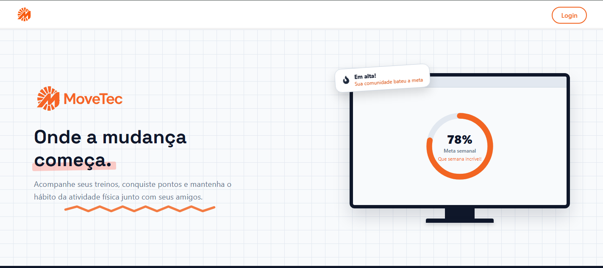
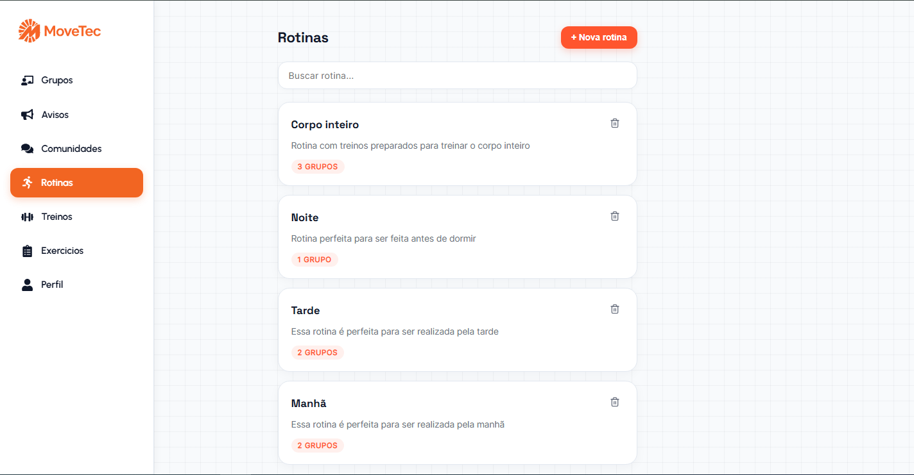
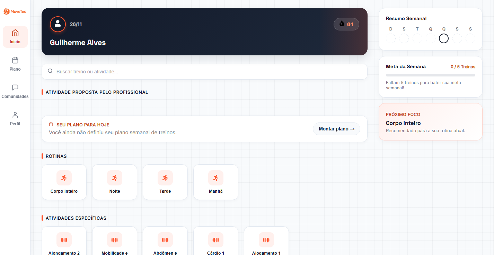

<div align="center">

# MoveTec — Sistema Web para Incentivo à Prática de Atividades Físicas no Ambiente Escolar


<p align="center">
  <strong>Trabalho de Conclusão de Curso (TCC) — ETEC de Campo Limpo Paulista</strong><br>
  <em>Ensino Médio com Informática para Internet M-Tec</em>
</p>

---

</div>

## 📌 Descrição

Muitos jovens em idade pré-vestibular têm dificuldade de começar uma rotina de atividades físicas e, principalmente, de mantê-la. Entre as barreiras mais apontadas estão a falta de tempo e a falta de motivação, além do uso constante do smartphone, da timidez diante da turma e das limitações de espaço e estrutura da escola, o que dificulta acompanhar cada jovem de perto.
Foi pensando nisso que nasceu o MoveTec. Nosso objetivo foi criar uma plataforma que não fosse apenas "mais um aplicativo de treino", mas um ambiente web em que o jovem pudesse seguir rotinas simples, com exercícios que exigem pouco ou nenhum equipamento, realizar as atividades atribuídas pelo profissional, registrar o que fez, definir metas, acompanhar seu progresso e se motivar com conquistas e desafios (gamificação). O profissional de Educação Física atribui atividades, acompanha o desempenho de cada jovem e avalia as entregas por meio de feedbacks.
Durante o desenvolvimento, aplicamos um questionário on-line com 58 estudantes do Ensino Médio da ETECAMP e entrevistamos um professor de Educação Física. Entre os jovens que não praticam atividades físicas, a falta de tempo e a falta de motivação foram as principais dificuldades, e entre os que praticam, houve interesse por metas claras e pelo acompanhamento do progresso. Com base nesses resultados, unimos a tecnologia web e a escola para criar uma ferramenta que busca apoiar o hábito de se exercitar.
---

## 👥 Equipe

**Camila Pelinson e Silva** Documentação e arquivo
**Livia Rafaelli Quatroque** Documentação e arquivo
**Milton Alecrim dos Santos** Front e Back-end

### 🎓 Corpo Docente / Orientação
- **Profª. Barbara Porfirio** — Orientadora de TCC
- **Profª. Thaynara Maia** — Orientadora de TCC

---

## 💻 Tecnologias Utilizadas

### Front-end
- **HTML5 e CSS3** — Estrutura, estilização e responsividade da interface.
- **JavaScript e TypeScript** (`6.0.2`) — Desenvolvimento da lógica da aplicação.
- **React** (`19.2.8`) — Construção da interface baseada em componentes.
- **Vite** (`8.2.0`) — Ferramenta de desenvolvimento e build.
- **React Router DOM** (`7.18.2`) — Gerenciamento de rotas da aplicação.
- **Axios** (`1.19.0`) — Comunicação com a API REST.
- **Socket.io Client** (`4.8.3`) — Comunicação em tempo real.
- **React Icons** (`5.7.0`) e **Canvas Confetti** (`1.9.4`) — Ícones e efeitos visuais de gamificação.

### Back-end
- **Node.js** (`22.14.0`) — Ambiente de execução JavaScript.
- **Express** (`5.2.1`) — Construção do servidor e da API REST.
- **Socket.io** (`4.8.3`) — Comunicação em tempo real.
- **JSON Web Token (JWT)** (`9.0.3`) — Autenticação e gerenciamento de tokens de acesso.
- **Passport.js** (`0.7.0`) e **Passport-Local** (`1.0.0`) — Estratégias de autenticação.
- **Express Mongo Sanitize** (`2.2.0`) — Proteção contra determinados padrões de injeção NoSQL.
- **CORS** (`2.8.6`) — Configuração do compartilhamento de recursos entre diferentes origens.

### Banco de Dados
- **MongoDB Atlas** — Serviço de banco de dados NoSQL em nuvem.
- **MongoDB Driver** (`7.5.0`) — Integração entre o Node.js e o MongoDB.

---

## 📸 Demonstração do Sistema

### 🏠 Tela Inicial — Landing Page (Seção Clara)



---

### 🏋️‍♂️ Gestão de Rotinas — Painel do Profissional




---

### 🏫 Home do Estudante



## 🚀 Como Executar o Projeto (Passo a Passo)

### 📋 Pré-requisitos
- [Node.js](https://nodejs.org/) versão 18 ou superior (Recomendado v22+)
- [Git](https://git-scm.com/) instalado no computador
- Conta no [MongoDB Atlas](https://www.mongodb.com/cloud/atlas) ou instância local do MongoDB

---

### 1. Clonar o Repositório
```bash
git clone https://github.com/Mirtu-AI/MoveTecTCC.git
cd MoveTecTCC
```

---

### 2. Configurar e Iniciar o Back-end
1. Acesse o diretório do servidor:
   ```bash
   cd backend
   ```
2. Instale as dependências:
   ```bash
   npm install
   ```
3. Crie o arquivo `.env` baseado no exemplo `.env.example`:
   ```bash
   cp .env.example .env
   ```
   *Preencha a variável `MONGO_URI` com a sua string de conexão do MongoDB e defina um `JWT_SEGREDO`.*

4. Inicie o servidor da API:
   ```bash
   npm run dev
   ```
   O servidor estará ativo em: [http://localhost:3000](http://localhost:3000)

---

### 3. Configurar e Iniciar o Front-end
1. Abra um novo terminal e acesse a pasta da aplicação web:
   ```bash
   cd frontend
   ```
2. Instale as dependências:
   ```bash
   npm install
   ```
3. Inicie o ambiente de desenvolvimento Vite:
   ```bash
   npm run dev
   ```
4. Acesse a aplicação no seu navegador pelo endereço fornecido (geralmente `http://localhost:5173`).

---

## 📖 Como Citar o Projeto

```text
PELINSON E SILVA, Camila; QUATROQUE, Livia Rafaelli; DOS SANTOS, Milton Alecrim. MoveTec: DESENVOLVIMENTO DE UM SISTEMA WEB PARA INCENTIVAR A PRÁTICA DE ATIVIDADES FÍSICAS ENTRE JOVENS ESTUDANTES EM FASE PRÉ-VESTIBULAR.. Orientadoras: Barbara Porfirio; Thaynara Maia dos Santos. 2026. Artigo Científico, apresentado como Trabalho de Conclusão de Curso (Ensino Técnico em Informática para Internet) – ETECAMP: ETEC de Campo Limpo Paulista, Campo Limpo Paulista, 2026.
```

- **Em caso de dúvidas, entre em contato:** [miltonalecrimdossantos@gmail.com](mailto:miltonalecrimdossantos@gmail.com)
- **Repositório Institucional do Centro Paula Souza:** [Repositório Institucional do Centro Paula Souza](https://ric.cps.sp.gov.br/)
